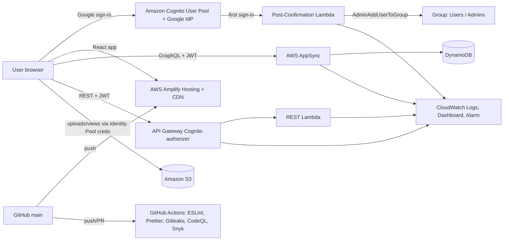

# CloudGallery: serverless photo gallery on AWS Amplify (Gen 2)

## Architecture (request flow)

Paste the Mermaid into mermaid.live and export PNG/SVG for your PDF, or redraw in draw.io.

## Setup steps

1. **AWS account safety first:** create a Budget with an alert at $1 (Billing > Budgets). Use **ap-southeast-2 (Sydney)** for everything (set it in the console top-right, in Amplify, and in any `aws configure`).
2. **Google OAuth:** Google Cloud Console > APIs & Services > Credentials > OAuth client (Web). Authorized redirect URI: `https://<your-cognito-domain>.auth.<region>.amazoncognito.com/oauth2/idpresponse`. (The domain appears after first sandbox deploy; add it then.)
3. `npm install`, then `npx ampx sandbox secret set GOOGLE_CLIENT_ID` and `GOOGLE_CLIENT_SECRET`. Run `npx ampx sandbox` (needs AWS credentials via `aws configure sso`/IAM Identity Center) to test locally. It generates `amplify_outputs.json`; `npm run dev`.
4. Push to GitHub. Amplify Console > Create app > GitHub > pick repo/main. Add the same two secrets under Hosting > Secrets. Replace `YOUR_APP_ID` in `amplify/auth/resource.ts` with the Amplify domain and push again.
5. GitHub repo > Settings > Secrets > add `SNYK_TOKEN` (free Snyk account). Enable CodeQL/secret scanning if asked.
6. Sign in with Google, then check Cognito > Groups: your user should be in `Users`. Manually add yourself to `Admins` for the second group demo.
7. CloudWatch: Dashboards > `cloudgallery-dashboard`; click "Call REST API" a few times; screenshot the graphs and the Lambda log group `/aws/lambda/...rest-function...`. For the alarm, temporarily throw an error in the handler to trigger it.

## Staying inside the free tier

Cognito (10k MAU), Lambda, API Gateway, AppSync, DynamoDB, S3 and Amplify builds all have free allowances at this scale. Common failures: no billing card or unverified card, wrong region, forgetting `ampx sandbox delete` (leftover sandboxes), and large S3 uploads. Check the current Free Tier terms. New accounts now often get a credits-based plan, so verify what yours gives you.

## Notes (v2)

- **Alarm email:** edit `ALARM_EMAIL` in `amplify/backend.ts`; click the AWS confirmation email or no alerts arrive.
- **Redirect URIs:** Cognito domain looks like `https://<prefix>.auth.ap-southeast-2.amazoncognito.com/oauth2/idpresponse` (add to Google). `callbackUrls` need your `https://main.<appid>.amplifyapp.com/`.
- **Production secrets:** add `GOOGLE_CLIENT_ID` / `GOOGLE_CLIENT_SECRET` in Amplify Console > Hosting > Secrets (sandbox secrets don't carry over). Don't commit `amplify_outputs.json`; Amplify generates it at build time.
- Run `npm run format` once before your first push so the Prettier CI check passes.

## Findings report outline (1 page)

Cover: what serverless removes (no servers, pay per use); how Cognito, groups and triggers fit together; infrastructure as code (CDK) vs. console clicks; why CI checks matter (they caught X); hardest problem and how you debugged it (CloudWatch logs); what you'd improve (WAF, presigned thumbnails, tests).
